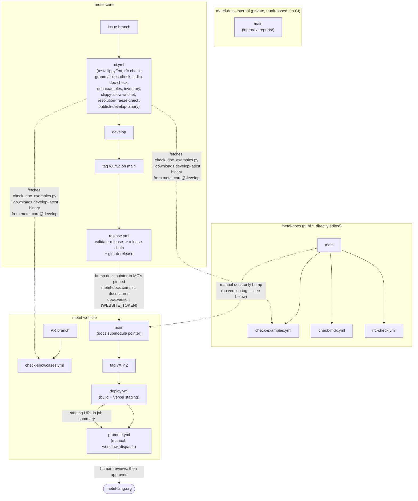

# Scripts and CI Processes

What every workflow, script, hook and command across the four repositories does, which
requirement it implements and which repository owns it is stated in the
**[Operations Specification](docs/operations/index.md)** (`operations/` in `metel-docs`):

- [`inventory.md`](docs/operations/inventory.md) maps every asset to the `PROC-*`
  requirements it implements. `check_operations.py` discovers the assets and fails or warns when
  one is unmapped or a row names something that no longer exists (PROC-CI-008).
- The requirements state each trigger, product, owner and verification, including the secrets by
  class (PROC-RELEASE-009), the example-checker exclusions (PROC-DOCS-010) and the manual docs-only
  publish procedure (PROC-DEPLOY-006).
- [`RELEASING.md`](RELEASING.md) is the release runbook and [`AGENTS.md`](AGENTS.md) the working
  rules.

This file used to carry per-asset tables that duplicated the inventory and drifted from it
(metel-core#687, #1528, #1533). It now holds only the cross-repository diagram below, which moves
into the specification with checks against drift in metel-core#1534. Treat it as an overview, not as
the reference: where it and the specification disagree, the specification wins.

Solid arrows are automated triggers or writes. Dashed arrows are a runtime fetch or the one manual
path that has no workflow (PROC-DEPLOY-006).
